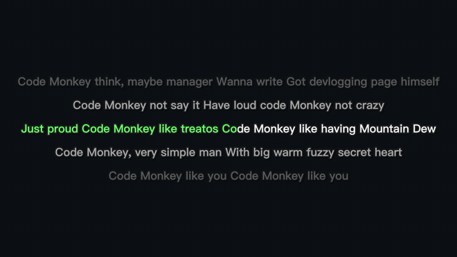

# karaoke-pipeline

Turn **one legally-owned audio file** into a karaoke lyrics video — in two
formats (original mix + no-vocal instrumental) — fully local, no paid APIs.

```
[audio] ──demucs──► vocals.wav + no_vocals.wav
                       │              │
              whisper (word ts)       │
                       │              │
                  .ass  \kf  ──► ffmpeg burn-in ──► <name>.original.mp4
                                                └─► <name>.karaoke.mp4  (+ .no_vocal.wav)
```



*Scrolling multi-line view (`bin/karaoke_scroll.py`), rendered from Jonathan
Coulton's "Code Monkey" — [CC BY-NC 3.0](https://creativecommons.org/licenses/by-nc/3.0/).*

## Legal note (read first)

This tool does **not** acquire music. Feed it audio **you already own the right
to use** — your own CD rips, purchased downloads, or Creative-Commons tracks.
For a legally-clear test track, *Code Monkey* by Jonathan Coulton is **CC BY-NC
3.0** (free for non-commercial use with attribution) and is available from the
Internet Archive. Nothing copyrighted is bundled with this repo — see
`.gitignore`, which deliberately keeps all audio/video and any transcribed-lyric
JSON out of version control.

## Usage

```bash
bin/karaoke.sh <input-audio> [--lang en|yue|zh|auto] [--res 1280x720]
                             [--device mps|cpu] [--model large-v3-turbo]
```

- `--lang` — Whisper language. `en` for English; `yue` for Cantonese (Cantopop),
  `zh` for Mandarin. `auto` = detect.
- `--device` — Demucs device. `mps` (Apple GPU, default) or `cpu`. Auto-falls
  back to cpu if mps errors. (Whisper runs on cpu — openai-whisper's MPS path is
  unreliable.)
- Outputs land in `out/`.

### Batch a folder

```bash
for f in ~/Music/album/*.flac; do bin/karaoke.sh "$f" --lang en; done
```

## What each piece does

| Step | Tool | Output |
|------|------|--------|
| Stem split | Demucs `htdemucs --two-stems=vocals` | `vocals.wav`, `no_vocals.wav` |
| Lyric timing | openai-whisper (`--word_timestamps`) on the **vocals** stem | `vocals.json` |
| Karaoke subs | `whisper_to_ass.py` (`\kf` fill-sweep per word) | `track.ass` |
| Render | `ffmpeg-full` + libass `ass=` filter | two `.mp4` + `.no_vocal.wav` |

Intermediate artifacts live in `work/<hash>/` (per song, ascii-safe dir so the
`ass=` filter never trips over spaces/CJK in real titles).

`bin/` also carries a few extras used to build richer outputs: `karaoke_scroll.py`
(scrolling multi-line view — past/active/future lines, lyrics persist through
interludes), `lrc_to_cues.py` / `whisper_to_cues.py` + `cues_to_ass.py` (drive the
same view from a timed `.lrc` or from Whisper), and `ocr_hardsubs.py` / `bench.py` /
`ssm.py` (OCR burned-in subs, benchmark ASR-vs-OCR, chroma self-similarity).

## Requirements

- `ffmpeg-full` (has libass): `brew install ffmpeg-full`
- `uv` + a sibling `.venv` (demucs/torch, Python 3.11)
- `uvx` for openai-whisper (ephemeral env, downloads model on first run)

## Tuning for CJK (no-space languages)

- Cantonese/Mandarin have no spaces; `whisper_to_ass.py` treats each whisper
  "word" token as a sweep unit, which for CJK is per-character-ish — generally
  fine for karaoke feel.
- Whisper `large-v3-turbo` handles Cantonese but timing on dense/fast lines can
  drift — if a line's sweep lags, `medium` sometimes aligns better; try both.
- If you have an official timed `.lrc`, prefer feeding that (via `lrc_to_cues.py`)
  over ASR — cleaner timing, no transcription errors.

## Extending

- **Album-art backdrop**: swap the solid `color=` source for the embedded cover
  art, blurred (`boxblur`), for a nicer background.
- **GPU node**: for large batches, run Demucs on a CUDA machine; the render step
  stays cheap and local.
